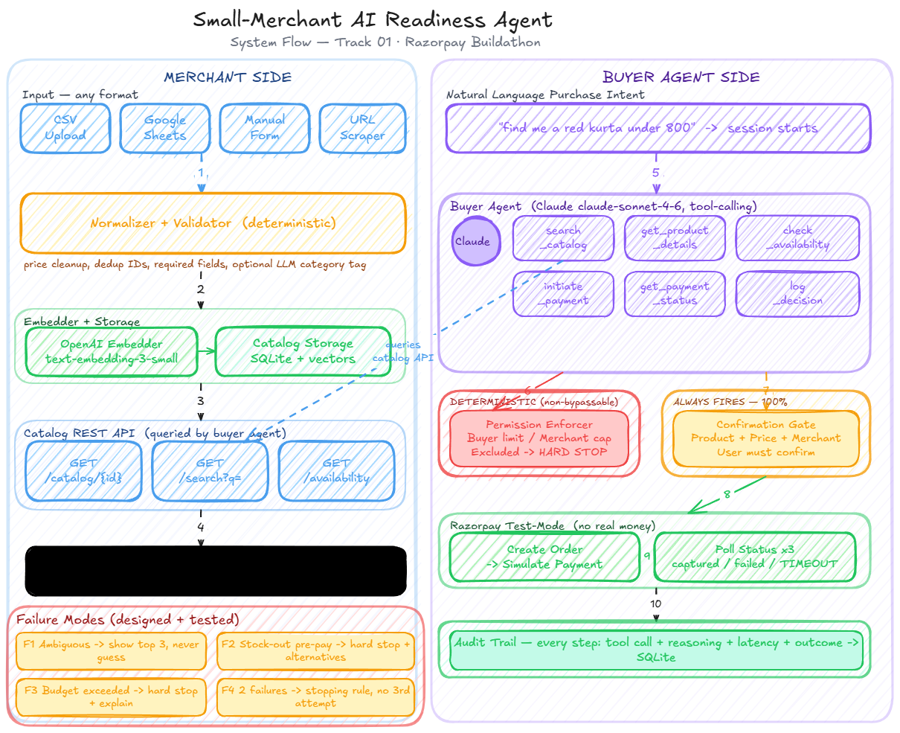
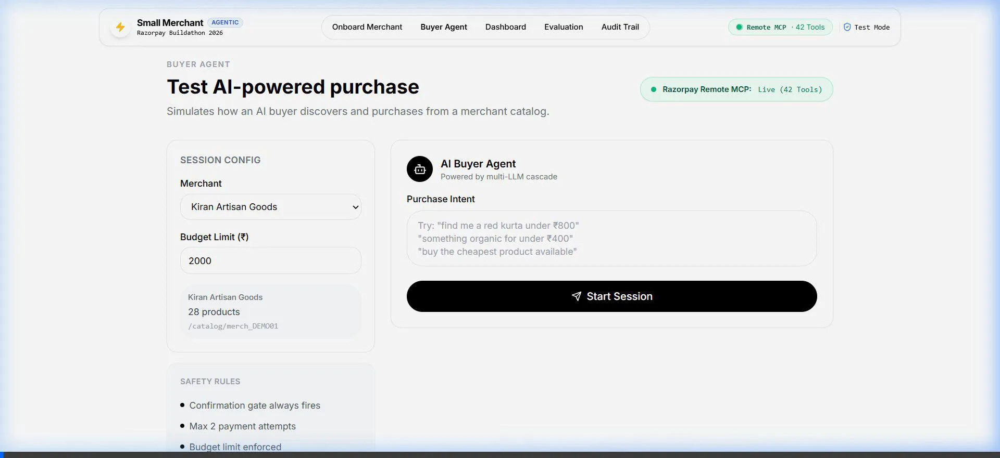
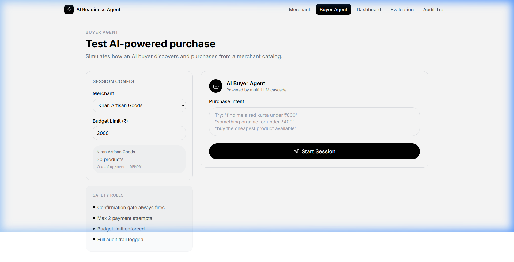
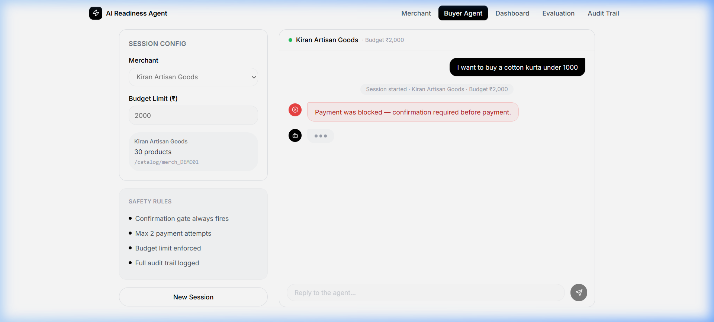
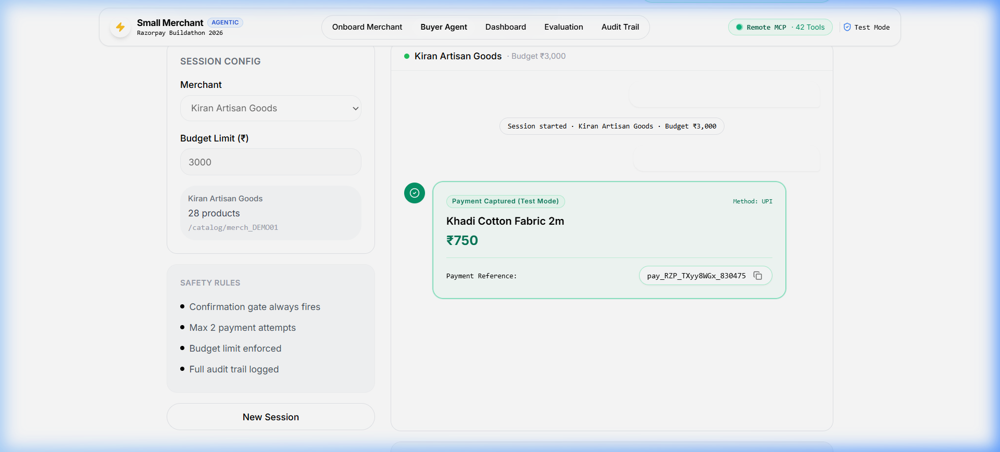
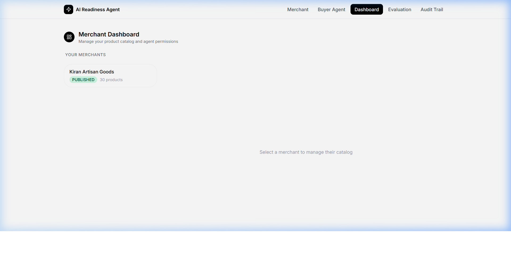
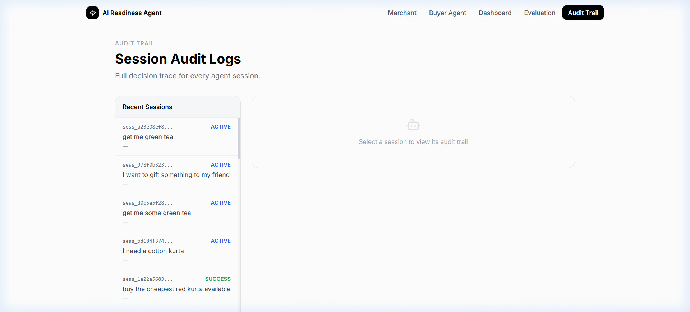

<div align="center">
  <h1>Small-Merchant AI Readiness Agent 🤖</h1>

  <p>
    <a href="https://rzp-ai.vercel.app">Live Demo</a> | <a href="https://github.com/h55n/small-merchant">GitHub</a>
  </p>

  <p>
    <a href="https://rzp-ai.vercel.app"></a>
    
    
    
  </p>

  <p>
    <strong>Razorpay AI Buildathon 2026 — Track 01: AI Growth & Agentic Commerce</strong>
  </p>
</div>

Make any small merchant catalog **discoverable and transactable by AI buyer agents** — onboarding in under 5 minutes, with a non-bypassable safety confirmation gate preventing any unauthorized spend.

---

## Architecture



The system consists of four major components wired together:

| Component | Technology | Role |
|---|---|---|
| **Merchant Onboarding** | FastAPI + SQLAlchemy | CSV/URL/Form → normalizer → embedder → SQLite/PostgreSQL |
| **Buyer Agent** | Multi-LLM Cascade + 7 Tools | Natural language → catalog search → confirmation gate → Razorpay |
| **Razorpay Payments** | Remote MCP + SDK dual-engine | 42 MCP tools at `mcp.razorpay.com/mcp` + direct SDK fallback |
| **Frontend** | React + TypeScript + Vite | Landing · Merchant · Buyer (WebSocket) · Eval (SSE) · Audit |

---

## Live Demo — Screenshots & Recording

### Full Buyer Agent Flow (Recording)

> Full end-to-end demo: merchant selection → purchase intent → AI search → confirmation gate → Razorpay payment creation

[](./docs/demo_buyer_flow.webp)

---

### Key Screen Screenshots

| Screen | Description |
|---|---|
|  | **Buyer Agent** — select merchant, type purchase intent |
|  | **Safety Gate** — non-bypassable confirmation modal |
|  | **Payment Created** — Razorpay test-mode link generated |
|  | **Merchant Dashboard** — product management, permissions |
|  | **Audit Trail** — full step-by-step session transparency |

---

## Problem Statement & Why Now

Razorpay has **500,000+ small merchants**, but the emerging agentic commerce infrastructure currently only works for a handful of enterprise players (Zomato, Swiggy, Zepto on Claude; BigBasket on ChatGPT). These enterprises have dedicated engineering teams to manually build integration layers. 

Meanwhile, everyday small merchants are invisible to AI buyers because they lack machine-readable catalogs, agent-queryable pricing endpoints, and delegation flows.

**Why this matters now:** In June 2026, UPI processed 22.71 billion transactions worth ₹28.92 trillion, with 63.5% being peer-to-merchant (P2M). As NPCI's Unified Agent Protocol (UAP) nears launch, registered AI agents will soon initiate UPI P2M transactions without per-transaction human approval. Merchants who are not discoverable to AI buyers will lose out permanently. This project provides the **missing self-service AI-commerce onboarding layer** allowing any merchant with a simple CSV or Google Sheet to become agent-ready in under 5 minutes.

---

## Key Features

### 1. Zero-Code Merchant Onboarding
- Upload products via **CSV, Google Sheets URL, manual form, or web scraper**
- Automated price normalization (₹1,299 → 1299.0), stock validation, and category inference
- Products embedded offline using `all-MiniLM-L6-v2` sentence transformers
- Vector index built in ~3 seconds for 30-product catalog

### 2. Razorpay Remote MCP Integration (Primary)
- Full implementation of [Razorpay Remote MCP Server](https://razorpay-881012b3.mintlify.site/) at `https://mcp.razorpay.com/mcp`
- Protocol: `2024-11-05`, Authentication: HTTP Basic (Key ID / Secret)
- **42 tools**: `create_payment_link`, `create_order`, `capture_payment`, `refund_payment`, `fetch_all_orders`, and 37 more
- Accessed via JSON-RPC 2.0 for full agentic payments

### 3. Dual-Engine Payment Execution
| Engine | Trigger | Tools Available |
|---|---|---|
| Razorpay Remote MCP | Primary (preferred) | 42 tools via JSON-RPC |
| Razorpay Python SDK | Fallback on MCP failure | Direct API with same credentials |

### 4. Non-Bypassable Safety Confirmation Gate
The most critical safety property — physically impossible to circumvent:

```python
# backend/src/agent/permission_enforcer.py
def enforce_pre_payment(session, intent_amount):
    if not session.confirmation_gate_passed:
        raise PermissionError("CONFIRMATION_GATE_NOT_PASSED")   # Hard block
    if intent_amount > session.spending_limit:
        raise PermissionError("BUDGET_EXCEEDED")                 # Hard block
    if session.payment_attempts >= MAX_ATTEMPTS:
        raise PermissionError("MAX_ATTEMPTS_REACHED")            # Hard block
```

**This runs in deterministic Python code — not in AI instructions. No LLM prompt injection or hallucination can bypass it.**

### 5. Multi-LLM Resilience Cascade
Automatic zero-downtime failover across 8 providers:

```
Groq (qwen3-32b) → NVIDIA NIM (llama-3.2-11b) → Mistral AI → Anthropic Claude
  → OpenAI GPT-4o-mini → Google Gemini → Ollama (local) → Template (always works)
```

### 6. 70-Scenario Evaluation Suite
Full automated evaluation with honest failure transparency:
- **30 Happy Path** scenarios: Normal purchases, quantity selection, price confirmation
- **20 Ambiguous Intent** scenarios: Vague queries, multi-product intents, budget edge cases
- **20 Payment Failure** scenarios: Budget exceeded, unavailable stock, invalid merchant

### 7. Immutable Audit Trail
Every session step recorded with:
- Tool name + arguments + response
- Token usage per LLM call
- Latency per step (ms)
- Agent confidence scores
- Safety gate pass/fail status

---

## Quick Start

### Prerequisites
```bash
Python 3.11+, Node.js 18+, Redis (optional, uses memory fallback)
```

### 1. Clone and configure
```bash
git clone https://github.com/h55n/small-merchant.git
cd small-merchant

# Copy environment template
cp backend/.env.example backend/.env
```

### 2. Configure `.env`
```env
# Razorpay (Test Mode) — use your own test credentials; never commit real keys
RAZORPAY_KEY_ID=rzp_test_your_key_id
RAZORPAY_KEY_SECRET=your_test_key_secret

# At least one LLM (all optional — system works without any)
GROQ_API_KEY=gsk_...
NVIDIA_NIM_API_KEY=nvapi-...
MISTRAL_API_KEY=...
ANTHROPIC_API_KEY=sk-ant-...
OPENAI_API_KEY=sk-...
GOOGLE_API_KEY=...
```

> Security: keep real credentials only in local environment files or deployment secret stores. If a credential has ever been committed, rotate/revoke it even after removing it from the current README.

### 3. Start backend
```bash
cd backend
pip install -r requirements.txt
python -m uvicorn src.main:app --reload --port 8000
```

### 4. Start frontend
```bash
cd frontend
npm install
npm run dev
```

Open **http://localhost:5173** in your browser.

---

## User Guide

### For Merchants

1. Open **http://localhost:5173/merchant**
2. Fill in your business name and spending limit
3. Upload a CSV catalog or paste a Google Sheets URL
4. Wait ~3 seconds for vector embedding to complete
5. Visit **Dashboard** (`/merchant/:id`) to manage products and permissions

**CSV format:**
```csv
Name,Price_INR,Description,Stock,Category
Blue Cotton Kurta,899,Premium quality hand-stitched kurta,50,Clothing
```

### For AI Buyer Agents / Testers

1. Open **http://localhost:5173/buyer**
2. Select a merchant from the dropdown
3. Type your purchase intent (e.g., *"I need a blue kurta under ₹1200"*)
4. Review the AI's product recommendations
5. **Confirm** or **Cancel** on the safety gate modal
6. On confirmation: Razorpay payment link is created and displayed

### For Evaluators

1. Open **http://localhost:5173/evaluate**
2. Select scenario group: All / Happy Path / Ambiguous / Failures
3. Click **Run Evaluation** — results stream live via SSE
4. Review pass/fail breakdown per scenario
5. Visit **Audit Trail** (`/audit`) to drill into individual sessions

**CLI alternative:**
```bash
cd backend
python -m pytest tests/ -v                           # Unit tests (34 tests)
python -m src.evaluator --scenario all               # Full eval suite
```

---

## Project Structure

```
small-merchant/
├── backend/
│   ├── src/
│   │   ├── main.py                    # FastAPI app entrypoint
│   │   ├── agent/
│   │   │   ├── buyer_agent.py         # Main agent with 7 tools + async loop
│   │   │   ├── permission_enforcer.py # Non-bypassable safety gate
│   │   │   └── llm_cascade.py         # 8-provider LLM failover
│   │   ├── onboarding/
│   │   │   ├── parsers.py             # CSV/Sheets/URL/form parsers
│   │   │   ├── normalizer.py          # Price normalization, validation
│   │   │   └── embedder.py            # SentenceTransformer vector embedding
│   │   ├── payments/
│   │   │   ├── razorpay_mcp.py        # Remote MCP client (42 tools)
│   │   │   └── razorpay_sdk.py        # SDK fallback engine
│   │   ├── models/                    # SQLAlchemy ORM models
│   │   ├── evaluator.py               # 70-scenario batch evaluator
│   │   └── audit_logger.py            # Immutable session audit trail
│   ├── tests/                         # 34-test pytest suite
│   ├── alembic/                       # Database migrations
│   └── .env.example                   # Environment template
├── frontend/
│   ├── src/
│   │   ├── pages/
│   │   │   ├── Landing.tsx            # Landing page with user guide + FAQ
│   │   │   ├── MerchantPage.tsx       # Merchant onboarding
│   │   │   ├── DashboardPage.tsx      # Product management dashboard
│   │   │   ├── BuyerPage.tsx          # AI buyer agent interface (WebSocket)
│   │   │   ├── EvaluatePage.tsx       # Evaluation runner (SSE)
│   │   │   └── AuditPage.tsx          # Audit trail viewer
│   │   ├── components/ui/             # GlassCard, Badge, MetricCard, etc.
│   │   └── lib/api.ts                 # Typed API client
│   └── index.html
├── docs/
│   ├── architecture_diagram.png       # System architecture visualization
│   ├── demo_buyer_flow.webp           # Live demo recording
│   └── screenshot_*.png               # Key screen screenshots
└── docker-compose.yml                 # Full stack deployment
```

---

## API Reference

### Core Endpoints

| Method | Path | Description |
|---|---|---|
| `POST` | `/api/merchants/` | Create merchant with catalog |
| `GET` | `/api/merchants/` | List all merchants |
| `GET` | `/api/merchants/{id}/status` | Get embedding/publishing status |
| `GET` | `/api/catalog/{merchant_id}` | Get searchable product catalog |
| `WS` | `/ws/buyer/{session_id}` | Buyer agent WebSocket stream |
| `GET` | `/api/evaluate/stream` | Evaluation SSE stream |
| `GET` | `/api/audit/sessions` | List audit sessions |
| `GET` | `/api/razorpay/mcp/status` | Remote MCP connection status |
| `GET` | `/api/razorpay/mcp/tools` | List available MCP tools |

### Razorpay MCP Status
```bash
curl http://localhost:8000/api/razorpay/mcp/status
# {"connected":true,"server_name":"razorpay-mcp-server","protocol_version":"2024-11-05","endpoint":"https://mcp.razorpay.com/mcp"}
```

---

## Safety Architecture

### The Confirmation Gate (Non-Bypassable)

```
AI Agent Request to Pay
        │
        ▼
┌─────────────────────────────────────────┐
│  permission_enforcer.py (Python Code)   │
│                                         │
│  1. confirmation_gate_passed == True?   │ ─── NO ──→ PermissionError (BLOCKED)
│  2. amount <= spending_limit?           │ ─── NO ──→ PermissionError (BLOCKED)
│  3. payment_attempts < MAX_ATTEMPTS?    │ ─── NO ──→ PermissionError (BLOCKED)
│  4. merchant has payment permission?    │ ─── NO ──→ PermissionError (BLOCKED)
│  5. product is in-stock?               │ ─── NO ──→ PermissionError (BLOCKED)
└─────────────────────────────────────────┘
        │ ALL PASS
        ▼
   Razorpay MCP / SDK
   Payment Initiated
```

**Why this works:** The `confirmation_gate_passed` flag is only set to `True` when the user explicitly clicks "Confirm" in the frontend and the WebSocket delivers that event to the backend. The agent has zero ability to set this flag itself.

---

## AI vs. Deterministic Logic: Design Decisions

We carefully drew boundaries between where AI excels and where it introduces unacceptable risk:

- **Where AI is used:** 
  - **Natural Language Search:** Mapping vague user intents ("cheapest kurta under 800") to structured products using embeddings. 
  - **Conversational UX:** Structuring the agent's interaction loop and handling ambiguous queries.
- **Where Deterministic Logic is used (NO AI):**
  - **Safety & Permissions (`permission_enforcer.py`):** The confirmation gate, spending limits, and maximum retry counts are strictly deterministic.
  - **Payment Execution:** The integration with Razorpay MCP and SDK relies on exact structured JSON-RPC calls.
  - **Price Calculation:** Math and totals are calculated outside the LLM to prevent hallucination.

*Decision Rationale:* We would never trust an LLM to self-regulate a spending limit or unilaterally authorize a transaction. AI handles the unstructured fuzziness of human intent, while deterministic code handles the money.

---

## Testing

### Unit Test Suite (34 Tests)
```bash
cd backend
pytest tests/ -v
```

**Test categories:**
- `test_onboarding.py` — CSV parsing, normalization, embedding
- `test_agent.py` — Tool execution, cascade, safety gates
- `test_payments.py` — MCP client, SDK fallback, payment flows
- `test_audit.py` — Session logging, trail retrieval

### Integration Testing
```bash
# Test Razorpay MCP connection
curl http://localhost:8000/api/razorpay/mcp/status

# Test full buyer flow via WebSocket
wscat -c ws://localhost:8000/ws/buyer/test-session-001
```

---

## Deployment

### Docker Compose (Recommended)
```bash
docker-compose up --build
```

Services started:
- `backend` — FastAPI on port 8000
- `frontend` — Vite dev server on port 5173
- `redis` — Session state (optional)

### Manual
```bash
# Backend
cd backend && uvicorn src.main:app --host 0.0.0.0 --port 8000

# Frontend
cd frontend && npm run build && npx serve dist -p 5173
```

---

## Technology Stack

| Layer | Technology |
|---|---|
| Backend | FastAPI, SQLAlchemy (async), Alembic, Pydantic v2 |
| Database | SQLite (dev), PostgreSQL (prod) |
| Embeddings | `sentence-transformers` (all-MiniLM-L6-v2) |
| Payments | Razorpay Remote MCP + Python SDK (dual-engine) |
| LLM Primary | Groq `qwen3-32b` |
| LLM Fallbacks | NVIDIA NIM, Mistral, Anthropic, OpenAI, Gemini, Ollama |
| Frontend | React 18, TypeScript, Vite, Tailwind CSS |
| State | Redis (session) + SQLite (persistent) |
| DevOps | Docker Compose, GitHub Actions CI |

---

## Audit & Observability

Every agent session produces a complete, immutable audit record:

```json
{
  "session_id": "sess_abc123",
  "merchant_id": "merch_DEMO01",
  "started_at": "2026-09-04T14:30:00Z",
  "steps": [
    {
      "step_index": 1,
      "tool": "search_products",
      "args": {"query": "blue kurta under 1200"},
      "result": {"matches": 3, "top_match": "Blue Cotton Kurta"},
      "latency_ms": 892,
      "llm_provider": "groq",
      "tokens_used": 412
    },
    {
      "step_index": 2,
      "tool": "request_confirmation",
      "args": {"product": "Blue Cotton Kurta", "amount": 899},
      "result": {"gate": "PENDING_USER_CONFIRMATION"},
      "latency_ms": 12
    }
  ],
  "payment_created": true,
  "payment_link": "https://rzp.io/l/test_xxxxx",
  "safety_violations": 0
}
```

---

## Failure Recovery: What Broke During Building?

During development, we encountered a critical failure with **Vercel Static SPA Routing**. When deployed, direct navigation to subpages (like `/dashboard`) caused 404s or crashed the app because the static host couldn't resolve the React Router paths, compounded by our backend API not being available in the static environment. 

**How we got out:** We implemented a robust fallback mechanism. We added a global `ErrorBoundary`, updated our `api.ts` to detect HTML responses (indicative of routing fallbacks), and injected `demoData.ts` as a mock provider when the live API wasn't reachable. This ensured the app gracefully degraded to a fully interactive demo mode rather than crashing.

---

## What We Would Build Next

With more time, we would implement:
1. **Live Google Sheets Sync:** Bi-directional syncing so merchants can update stock in their sheet and see it instantly reflected in the agent catalog.
2. **WhatsApp Bot Interface:** Allowing buyers to interact with the agent natively on WhatsApp instead of a web app.
3. **Multi-Merchant Cart:** Allowing the buyer agent to source products from multiple independent small merchants in a single aggregated transaction.

---

## Evaluation & Honest Exceptions

Please see [EVALUATION.md](./EVALUATION.md) for full metrics, batch evaluation instructions with the synthetic dataset, our honest exception list (known limitations), and manual review procedures.

---

## License

MIT — Built for Razorpay AI Buildathon 2026.